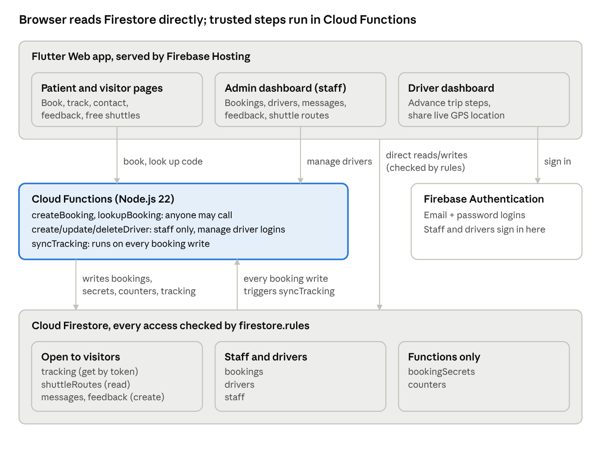

# Koru Website — Backend Documentation

Last updated: 2026-10-27

## Overview

The Koru Hospital Transport website has no custom server: its backend is Firebase, made of Cloud Firestore (the database), Firebase Authentication (staff and driver logins), six Cloud Functions (Node.js 22) and Firebase Hosting (serves the Flutter Web build). Everything runs in region asia-northeast1 under Firebase project `project-transportation-5b6d8`.

The backend supports four groups of users:

- **Patients / visitors** (not signed in): book a ride, track it with a reference + code, send contact messages and feedback, see free shuttle routes.
- **Staff** (signed in, listed in `staff/{uid}`): manage bookings, drivers, messages, feedback and shuttle routes from the admin dashboard.
- **Drivers** (signed in, listed in `drivers/{uid}` with `active == true`): see their assigned trips, move them forward, share live location.
- **Cloud Functions** (trusted server code): do the work the browser must never do itself — numbering bookings, hashing tracking codes, creating driver logins.

| Part | Technology | Where in the repo |
| --- | --- | --- |
| Database | Cloud Firestore (default database) | [firestore.rules](../firestore.rules), [firestore.indexes.json](../firestore.indexes.json) |
| Server logic | Cloud Functions v2, Node.js 22, firebase-admin 14 | [functions/index.js](../functions/index.js) |
| Login | Firebase Authentication (email + password) | used from [staff_auth.dart](../webside%20koru/lib/data/staff_auth.dart) |
| Website hosting | Firebase Hosting, serves `webside koru/build/web` | [firebase.json](../firebase.json) |
| Client data layer | Flutter (`cloud_firestore`, `cloud_functions`, `firebase_auth`) | [webside koru/lib/data/](../webside%20koru/lib/data/) |

## Architecture



The Flutter app reads and writes most data straight to Firestore, with the security rules deciding what each role may touch. Only steps that need secrets or admin powers (numbering bookings, hashing codes, creating logins) go through Cloud Functions, and `syncTracking` keeps the patient's safe tracking copy up to date after every booking change.

## Data model

All data lives in nine top-level Firestore collections. Three of them (`counters`, `bookingSecrets`, `tracking`) are written only by Cloud Functions; no browser can write them.

| Collection | Document id | Main fields | Written by | Read by |
| --- | --- | --- | --- | --- |
| `bookings` | `KR-1001`, `KR-1002`, … | ref, patient, phone, type, from, branch, date, time, needs, notes, pickup (GeoPoint), stage, vehicle, driver, driverUid, trip, tripUpdatedAt, driverLocation (GeoPoint), createdAt | `createBooking` function; staff; assigned driver (trip + location only) | Staff (all); driver (own only) |
| `bookingSecrets` | booking ref | codeHash (SHA-256), token, failedLookups, lockedUntil | Functions only | Functions only |
| `tracking` | random 32-char token | ref, type, branch, date, time, stage, trip, driver (first name), vehicle, driverLocation, updatedAt | `syncTracking` function | Anyone who knows the token (single get, no listing) |
| `counters` | `bookings` | next (next booking number, starts 1001) | Functions only | Functions only |
| `drivers` | Auth UID | name, phone, vehicle, email, active, createdAt | Driver functions; staff may toggle `active` | Staff; the driver themself |
| `staff` | Auth UID | (existence is what matters) | By hand in Firebase console | The person themself |
| `messages` | auto id | name, reply, topic, reference, message, date, handled | Visitors (create); staff (`handled`, delete) | Staff |
| `feedback` | auto id | rating (1–5), type, comment, date, name, ref, published | Visitors (create, hidden); staff (publish, delete) | Everyone if published; staff all |
| `shuttleRoutes` | `A`, `B`, `C` | destination, times (list of "HH:MM"), frequency (minutes or null), updatedAt | Staff | Everyone |

Fixed values used across the model:

- **Booking `type`:** ambulance, wheelchair, standard, airport.
- **Booking `needs`:** wheelchair, stretcher, oxygen, companion.
- **Booking `stage`** (set by staff): newRequest → confirmed → reserved → arranged.
- **Booking `trip`** (set by the driver once arranged): assigned → enRoute → arrived → onBoard → completed.
- **Message `topic`:** booking, change, shuttle, other.

[firestore.indexes.json](../firestore.indexes.json) defines no composite indexes; every query the site runs (orderBy `createdAt`, `date` or `name`; where `driverUid ==` or `published ==`) uses Firestore's automatic single-field indexes.

## Authentication & admin access

Staff and drivers sign in with Firebase Authentication (email + password), but a valid login alone grants nothing: the account must also be on a Firestore list. Patients never sign in; they use a booking reference plus a secret code instead.

| Role | How the account is created | What makes it valid |
| --- | --- | --- |
| Staff (coordinator) | Created in the Firebase console (Authentication), then a document `staff/{uid}` added by hand | `staff/{uid}` exists |
| Driver | Staff fill the driver form; the `createDriver` function creates the Auth user and `drivers/{uid}` | `drivers/{uid}.active == true` |
| Patient | No account | Knows the booking ref + 8-character code, or holds the tracking token |

Sign-in flow ([staff_auth.dart](../webside%20koru/lib/data/staff_auth.dart)):

1. The login page calls `signInWithEmailAndPassword` with the chosen role (staff or driver).
2. The app reads `staff/{uid}` or `drivers/{uid}`. If the account is not on the list, it signs straight back out and shows "not staff".
3. On success the app records `isStaff` / `isDriver` and `uid`, and the dashboards open.
4. Firestore rules repeat the same check on every read and write, so the app-side check is only for the UI.

**Forgot password:** the admin login page calls `sendPasswordResetEmail`. Firebase emails a reset link. For privacy the page says "sent" even when the email has no account.

**Disabling access:** staff can switch a driver's `active` flag off (blocks Firestore access immediately), or delete the driver (`deleteDriver` removes both the Auth user and the profile). Staff access is removed by deleting `staff/{uid}` in the console.

## Backend logic

Six Cloud Functions in [functions/index.js](../functions/index.js) hold all trusted logic; every other feature is the Flutter app talking to Firestore directly, guarded by the rules. All functions run in asia-northeast1 with at most 10 instances.

### Cloud Functions

| Function | Trigger | Who may call | What it does |
| --- | --- | --- | --- |
| `createBooking` | Callable (HTTPS) | Anyone | Validates the form, takes the next number from `counters/bookings` in a transaction, creates `bookings/KR-n` (stage newRequest) and `bookingSecrets/KR-n`. Returns ref, code and token. Keeps 1 warm instance. |
| `lookupBooking` | Callable (HTTPS) | Anyone | Checks ref + code against the stored hash (timing-safe). Returns the tracking token. After 5 wrong codes, locks the ref for 15 minutes. Keeps 1 warm instance. |
| `createDriver` | Callable (HTTPS) | Staff | Creates the Auth user (password ≥ 8 chars) and `drivers/{uid}` with active = true. |
| `updateDriver` | Callable (HTTPS) | Staff | Updates name, phone, vehicle, email; changes the password only if a new one is given. |
| `deleteDriver` | Callable (HTTPS) | Staff | Deletes the Auth user and `drivers/{uid}`. Old bookings keep the driver's name. |
| `syncTracking` | Firestore write on `bookings/{ref}` | System | Copies the safe fields of the booking to `tracking/{token}`; deletes tracking + secrets when a booking is deleted. |

### Feature flows

**Booking a ride**

1. Patient submits the booking form; the app calls `createBooking`.
2. The function returns e.g. `KR-1042`, an 8-character code (letters/digits without 0, O, 1, I, L) and a tracking token.
3. Only a SHA-256 hash of `ref:code` is stored, so the code cannot be read back from the database.
4. Writing the booking fires `syncTracking`, which creates the patient's `tracking/{token}` document.

**Tracking a ride**

1. Patient enters ref + code on the Track page; the app calls `lookupBooking` and receives the token.
2. The app listens live to `tracking/{token}` and stores the token in the browser (`shared_preferences`) so a refresh does not ask for the code again.
3. The tracking copy holds no patient name, phone, address or notes, and only the driver's first name (KVKK data minimisation). Driver location is included only while the trip is `enRoute` or `onBoard`.

**Dispatching (staff)**

1. The admin dashboard listens to all bookings, newest first.
2. Staff move each booking newRequest → confirmed → reserved → arranged, and set vehicle, driver and `driverUid`.
3. Each save triggers `syncTracking`, so the patient sees the change at once.

**Driving (driver)**

1. The driver dashboard listens to bookings where `driverUid` equals the driver's uid.
2. The driver taps to advance the trip one step (assigned → enRoute → arrived → onBoard → completed); `tripUpdatedAt` is set to server time.
3. While driving, the app writes the GPS position (`geolocator`) to `driverLocation`; it is cleared when the step no longer shares location.

**Contact, feedback, shuttles**

- **Contact form:** the app adds a document to `messages` (handled = false). Staff see a live list and mark messages answered or delete them.
- **Feedback:** saved with published = false. Staff publish a comment to show it on the site, or delete it.
- **Free shuttles:** staff save routes A, B, C (destination, departure times, frequency). Every visitor reads them live; the next bus is computed in Ankara time (UTC+3).

## Security rules and access control

[firestore.rules](../firestore.rules) is the real gatekeeper: the browser talks to Firestore directly, so every permission is enforced there, not in the Flutter code. Two helper checks decide roles: `isStaff()` (a `staff/{uid}` document exists) and `isDriver()` (`drivers/{uid}.active == true`).

| Collection | Visitor | Driver | Staff |
| --- | --- | --- | --- |
| `bookings` | None (create only via function) | Read own; update `trip` (one step forward only), `tripUpdatedAt`, `driverLocation`, and only when stage = arranged | Read all, update, delete; cannot change ref, patient, phone, from, pickup, needs, notes, createdAt; assigned driver must be active |
| `tracking` | Get one document by token; no listing | Same | Same |
| `bookingSecrets`, `counters` | None | None | None |
| `drivers` | None | Read own profile | Read all; update `active` only |
| `staff` | None | None | Read own document only |
| `messages` | Create only (fixed fields, size limits, handled = false, date = server time) | None | Read, delete, update `handled` only |
| `feedback` | Create (published = false, rating 1–5, comment ≤ 2000 chars); read published | Read published | Read, update, delete all |
| `shuttleRoutes` | Read | Read | Create/update routes A, B, C only (validated fields); no delete |

Other protections built into the functions:

- Tracking codes are hashed and compared with `crypto.timingSafeEqual`.
- `lookupBooking` gives the same error for "no such booking" and "wrong code", so references cannot be probed.
- 5 wrong codes lock a reference for 15 minutes.
- Driver functions call `requireStaff`, which re-checks `staff/{uid}` on the server.

The rules are covered by an emulator test suite in [functions/test/flow.test.js](../functions/test/flow.test.js): full booking-to-completion flow, rejected bad forms, patients blocked from private data, staff blocked from editing patient details, drivers blocked from skipping steps, code lockout, messages, shuttles and driver management.

## Configuration, setup and deployment

The whole backend deploys from the repository root with the Firebase CLI; [firebase.json](../firebase.json) wires Firestore, Functions, Hosting and the local emulators together.

| Setting | Value |
| --- | --- |
| Firebase project | `project-transportation-5b6d8` ([.firebaserc](../.firebaserc)) |
| Region (Firestore + Functions) | asia-northeast1 |
| Functions runtime | Node.js 22, firebase-functions 7, firebase-admin 14 |
| Hosting folder | `webside koru/build/web`, all paths rewritten to `/index.html` (single-page app) |
| Emulator ports | Auth 9099, Firestore 8080, Functions 5001, UI 4000 |
| Flutter Firebase config | `webside koru/lib/firebase_options.dart` |

**Run locally**

```
cd functions
npm install
npm run emulators      # starts Auth, Firestore, Functions + UI, seeds test accounts
```

`seed-emulators.js` creates test coordinators and drivers in the emulators only; it refuses to run against the real project.

**Test**

```
cd functions
npm run test:emulators   # rules + functions test suite
npm run test:app         # seeds, then runs the full app flow script
```

**Deploy**

```
cd "webside koru" && flutter build web
cd ..
firebase deploy --only firestore:rules,functions,hosting
```

After the first deploy, create each staff member in Authentication and add an empty `staff/{uid}` document by hand in the Firestore console.

## Known gaps and recommendations

The core booking, tracking and role model is sound and tested; the gaps below are mostly about abuse protection and loose ends before going live.

| # | Gap | Where | Suggested fix |
| --- | --- | --- | --- |
| 1 | No App Check and no rate limit on public endpoints: anyone can script `createBooking`, contact messages or feedback in bulk | `functions/index.js`, `firestore.rules` | Enable Firebase App Check (reCAPTCHA Enterprise) and set `enforceAppCheck: true` on the callables |
| 2 | Feedback create rule does not restrict which fields are sent or the size of `name`, `ref`, `type`, `date` | `match /feedback/{id}` | Add `keys().hasOnly([...])`, size limits and `date == request.time`, as `messages` already does |
| 3 | Coordinators are not notified of new bookings | `booking_page.dart` TODO | Add a Firestore-triggered function that emails or messages staff on `bookings` create |
| 4 | Staff accounts are added by hand in the console | `staff/{uid}` | Acceptable for a small team; document who owns this, or add a staff-only admin function later |
| 5 | Placeholder contact details and branch map points | `lib/data/bookings.dart` | Replace before launch |
| 6 | `minInstances: 1` on two functions costs a few dollars a month each | `PATIENT_FACING` in `functions/index.js` | Keep for fast patient responses, or set to 0 to save cost |
| 7 | Old `tracking` and `bookingSecrets` documents stay forever after a trip completes | `syncTracking` | Add a scheduled cleanup (e.g. delete N days after completion) for KVKK data retention |
