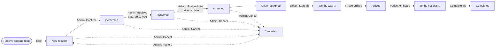

# Koru Hospital Transport — Website (frontend)

The patient-transport website for Koru Hospital, built with **Flutter Web** on a **Firebase** backend (Auth, Firestore, Hosting). There is no server code: the website writes to Firestore itself and the security rules check every write, so it runs on the free Spark plan.

One app serves four kinds of people:

| Who | Where | What they do |
|---|---|---|
| **Patients / visitors** | `/`, `/booking`, `/track`, `/contact`, `/feedback` | Book a ride, follow it live, send a message, rate the ride, see free bus times. |
| **Coordinators (staff)** | `/admin/login` → `/admin` | Confirm → reserve → assign a driver. Manage drivers, messages, feedback and free buses. |
| **Drivers** | `/driver/login` → `/driver` | See only their own trips, move each trip forward, share their location while driving. |

The backend lives next to this folder: the security rules in [`../firestore.rules`](../firestore.rules) and their tests in [`../firebase-tests/`](../firebase-tests/).

---

## Contents

1. [Quick start](#quick-start)
2. [Tech stack](#tech-stack)
3. [Folder structure](#folder-structure)
4. [How the app starts](#how-the-app-starts)
5. [Pages (routes)](#pages-routes)
6. [How a booking moves](#how-a-booking-moves)
7. [Data layer (`lib/data/`)](#data-layer-libdata)
8. [Firestore collections](#firestore-collections)
9. [Sign-in and roles](#sign-in-and-roles)
10. [How it is kept safe](#how-it-is-kept-safe)
11. [Languages](#languages)
12. [Theme, colors and layout](#theme-colors-and-layout)
13. [Shared widgets (`lib/widgets/`)](#shared-widgets-libwidgets)
14. [Maps and location](#maps-and-location)
15. [Running locally with emulators](#running-locally-with-emulators)
16. [Tests](#tests)
17. [Building and deploying](#building-and-deploying)
18. [Placeholders to fill in before launch](#placeholders-to-fill-in-before-launch)
19. [Common tasks (how do I…?)](#common-tasks-how-do-i)

---

## Quick start

```sh
# 1. Start the local Firebase emulators (needs Java, see below)
cd firebase-tests
npm install
npm run emulators

# 2. In a second terminal, run the website against them
cd "webside koru"
flutter pub get
flutter run -d chrome --dart-define=USE_EMULATORS=true
```

- Website: opens in Chrome automatically
- Emulator UI (see the data): http://localhost:4000
- Test coordinator login: `coordinator@koru.test` / `staff-pass-123`

---

## Tech stack

| Package | Used for |
|---|---|
| `flutter` (Web, Material 3) | The whole UI |
| `firebase_core` | Connecting to the Firebase project `project-transportation-5b6d8` |
| `firebase_auth` | Email + password sign-in for staff and drivers |
| `cloud_firestore` | Live data: bookings, drivers, messages, feedback, free buses, tracking |
| `crypto` | Turns the booking reference + tracking code into the tracking id (SHA-256) |
| `flutter_map` + `latlong2` | OpenStreetMap maps (route map, driver's car). No API key needed |
| `geolocator` | Driver's live location while driving |
| `google_fonts` | Manrope font |
| `shared_preferences` | Remembers in the browser: chosen color, patient's tracking link |
| `url_launcher` | Opens phone calls, WhatsApp, email and map links |
| `flutter_localizations` | Date/time pickers in the chosen language, right-to-left for Arabic |

Dart SDK `^3.5.0`. Firestore is in region **`asia-northeast1`**.

---

## Folder structure

```
webside koru/
├── lib/
│   ├── main.dart              App entry point: Firebase setup, emulators, routes
│   ├── theme.dart             Colors (AppColors), corner sizes, theme, Responsive
│   ├── lang.dart              Languages, context.t('English', 'Türkçe'), translate()
│   ├── translations.dart      French, Arabic and Russian texts
│   ├── firebase_options.dart  Firebase web config (generated by FlutterFire)
│   │
│   ├── data/                  Talks to Firebase; one "store" per kind of data
│   │   ├── bookings.dart      Booking model, stages, trip steps, BookingStore,
│   │   │                      contact details, branches, date/time formatting
│   │   ├── drivers.dart       Driver model + DriverStore (admin only)
│   │   ├── feedback.dart      Patient comments + FeedbackStore
│   │   ├── messages.dart      Contact form messages + MessageStore
│   │   ├── shuttles.dart      Free bus routes, time parsing, next departure
│   │   ├── staff_auth.dart    Staff / driver sign-in (StaffAuth)
│   │   └── tracking.dart      Patient lookup + live tracking
│   │
│   ├── pages/                 One file per screen
│   │   ├── home_page.dart
│   │   ├── booking_page.dart
│   │   ├── track_page.dart
│   │   ├── contact_page.dart
│   │   ├── feedback_page.dart
│   │   ├── admin_login_page.dart     (also the driver login)
│   │   ├── admin_dashboard_page.dart
│   │   ├── admin_overview.dart       ("Overview" section of the dashboard)
│   │   └── driver_dashboard_page.dart
│   │
│   └── widgets/               Pieces reused across pages
│       ├── site_layout.dart   Logo, header, menu, language switch, footer
│       ├── common.dart        Section container, headings, grid, stars, …
│       ├── route_map.dart     Map with pickup, destination and driver
│       └── color_picker.dart  Change the site's main color
│
├── assets/images/             Logos (and later: driver photos)
├── web/                       index.html, favicon, PWA manifest
├── test/                      Unit tests (flutter test)
├── tool/flow_check.dart       Full end-to-end check against the emulators
├── pubspec.yaml               Packages
└── analysis_options.yaml      Lint rules (flutter_lints)
```

---

## How the app starts

[`lib/main.dart`](lib/main.dart):

1. Connects to Firebase **and** loads the saved main color, in parallel.
2. If started with `--dart-define=USE_EMULATORS=true`, points Auth (9099) and Firestore (8080) at `localhost`.
3. `staffAuth.load()` — if a staff member or driver was signed in before the refresh, they stay signed in.
4. `runApp(KoruApp())` — builds `MaterialApp` with the theme, the current language and the routes.

`KoruApp` rebuilds when:
- **the language changes** (`langController`) — date pickers switch language too, and Arabic turns the page right-to-left;
- **the main color changes** (`colorController`) — every widget is marked to rebuild so all pages pick up the new color without losing form input.

---

## Pages (routes)

| Route | File | What is on it |
|---|---|---|
| `/` | [home_page.dart](lib/pages/home_page.dart) | Hero with a quick **booking bar** (service, from, to, date) → services cards → **next free buses** (live, refreshed every 30 s, Ankara time) → published patient comments → branch finder → "Our drivers". Menu links like *Shuttle* and *Directions* scroll to these parts. |
| `/booking` | [booking_page.dart](lib/pages/booking_page.dart) | 3-step form: **1** transport type, **2** patient name, phone, mobility needs (wheelchair, stretcher, oxygen, companion), notes, **3** pickup address, destination branch, tap-to-set pickup on the map, date, time, KVKK consent. A summary and an "Emergency? Call 112" box sit next to the form. After sending, shows the reference (`KR-1001`) and the secret 8-letter tracking code. Can be pre-filled from the homepage via `BookingDraft`. |
| `/track` | [track_page.dart](lib/pages/track_page.dart) | Patient types reference + code. Then shows live progress steps, booking details, driver's first name and plate, and the car on the map while driving. The browser remembers the booking, so a refresh keeps it open. |
| `/contact` | [contact_page.dart](lib/pages/contact_page.dart) | Phone / WhatsApp / email cards, a contact form (saved to `messages`), and the branch list. |
| `/feedback` | [feedback_page.dart](lib/pages/feedback_page.dart) | 1–5 stars, transport type, comment, optional name and reference. Saved to `feedback`; staff choose which ones appear on the homepage. |
| `/admin/login` | [admin_login_page.dart](lib/pages/admin_login_page.dart) | Staff sign-in, with a "forgot password" link (emails a reset link). |
| `/admin` | [admin_dashboard_page.dart](lib/pages/admin_dashboard_page.dart) | See [Admin dashboard](#admin-dashboard). Shows the login page if not signed in as staff. |
| `/driver/login` | same file, `role: Role.driver` | Driver sign-in. |
| `/driver` | [driver_dashboard_page.dart](lib/pages/driver_dashboard_page.dart) | See [Driver dashboard](#driver-dashboard). Shows the driver login if not signed in as a driver. |

Public pages use `SiteScaffold` (header + content + footer). The footer has the staff and driver login links.

### Admin dashboard

A side menu (a drawer on small screens) switches between sections:

- **Overview** ([admin_overview.dart](lib/pages/admin_overview.dart)) — patients today / yesterday / this month with % change, what needs a coordinator now, a day-by-day bar chart for a chosen month, breakdowns by transport type, branch and extra help, and rides coming up today and tomorrow. Counts use the **ride date**, not the booking date.
- **Bookings** — count tiles and tabs per stage (*New requests / Confirmed / Reserved / Arranged*), a search box (name, phone or reference) and a table with one action button per row:
  - *Confirm* → moves straight to Confirmed.
  - *Reserve* → dialog to set date, time and vehicle type.
  - *Assign driver* → dialog to pick an active driver and the vehicle plate (pre-filled with the driver's usual vehicle).
  - Arranged rows show the driver's latest trip step, live.
- **Drivers** — add (email + first password), edit (empty password keeps the old one), delete, and switch accounts on/off. A switched-off driver cannot sign in or see any booking.
- **Messages** — contact form messages, newest first; mark as answered or delete. The menu shows how many are unanswered.
- **Feedback** — average rating, every comment, show/hide on the homepage, delete.
- **Free buses** — for each route (A Çukurambar, B Sincan, C Kavaklıdere): destination, departure times (typed like `08:00, 9:30 12:00`) and frequency in minutes.

The side menu also has the language switch, the color picker and sign-out.

### Driver dashboard

- Lists only the trips assigned to the signed-in driver (live), sorted by date.
- One big button per trip moves it forward: **Start trip → I have arrived → Patient on board → Complete trip** (completing asks first).
- "Open in maps" opens the pickup point in the phone's map app.
- While a trip is *on the way* or *on board*, the driver's location is sent at most every **15 seconds**. A status line tells the driver whether location is reaching the patient (or that the browser blocked it). The location is cleared once the driver stops driving.

---

## How a booking moves



- The **stage** (`Stage` enum in [bookings.dart](lib/data/bookings.dart)) is moved by the coordinator: `newRequest → confirmed → reserved → arranged`. From any stage the coordinator can **cancel** (frees the time slot; the patient sees "Booking cancelled") or **reschedule** (moves it to another free hour; the patient sees the new time). A cancelled booking can be **restored** as a new request if its hour still has room.
- The **trip status** (`TripStatus` enum) is moved by the driver: `assigned → enRoute → arrived → onBoard → completed`. 📍 = location shared.
- Every change shows up live on the patient's `/track` page and in the admin dashboard.
- A coordinator with the dashboard open gets a pop-up for each new booking, and the side menu shows how many requests wait to be confirmed. (Email or SMS alerts would need server code; there is none.)

### Time slots and capacity

- Bookings are taken in **one-hour slots, 00:00 to 23:00**. The booking form shows the slots of the chosen day live, with places left; full, closed and past hours cannot be picked. Picking a full one shows *"This time slot is fully booked. Please choose another available time."* with the nearest free times that day.
- `slots/{YYYY-MM-DD}T{HH}` counts the bookings in each hour. A new booking adds one in the same transaction, and the **rules refuse it if that goes over the limit**, so two patients can never take the last place, even with a modified browser.
- The limit is **3 per hour** until a coordinator changes it in **Admin → Schedule** (“Bookings per hour”). One hour can get its own limit, or be closed (limit 0), from its ⋮ menu.
- **Admin → Schedule** shows a day at a time: each hour's status (Available / Booked / Fully booked / Closed), places used out of the limit, and who booked it, when, and the booking's stage, with reschedule, cancel and call buttons.
- Bookings made before slots existed hold no place until a coordinator saves them (confirm, reschedule…), which then takes one.

---

## Data layer (`lib/data/`)

Each file holds a model plus a **store**: a `ChangeNotifier` that listens to a Firestore collection and calls `notifyListeners()` when anything changes. There is **one global instance** of each (`bookingStore`, `driverStore`, `feedbackStore`, `messageStore`, `shuttleStore`, `staffAuth`, `tracking`). Pages listen to them with `ListenableBuilder`.

Stores that hold private data listen to `staffAuth`: when someone signs in or out, they cancel the old Firestore listener, clear their list and start the right query.

| Store | Collection | Who sees what | Writes |
|---|---|---|---|
| `bookingStore` | `bookings` | Staff: all (newest first). Driver: only `driverUid == me`. Visitors: nothing. | `add()` takes the next number and saves the booking + its tracking copy in one transaction. `advance()` saves the admin's changes. `nextTripStep()`, `shareLocation()` for drivers. Every change also rewrites the tracking copy in the same batch. |
| `driverStore` | `drivers` | Staff only, sorted by name. | `add()` creates the sign-in account through a second Firebase app (so the coordinator stays signed in), then the profile. `edit()` (name, phone, vehicle), `sendPasswordReset()`, `delete()` (profile only), `setActive()`. |
| `feedbackStore` | `feedback` | Staff: all. Visitors: only `published == true`. | `add()` (anyone), `setPublished()`, `remove()` (staff). |
| `messageStore` | `messages` | Staff only. | `send()` (anyone), `setHandled()`, `remove()` (staff). |
| `shuttleStore` | `shuttleRoutes` | Everyone. | `save()` (staff). Bad values in the database are ignored so they never show on the homepage. |
| `tracking` | `tracking/{token}` | Whoever holds the token. | `lookup()` works out the id from reference + code and reads it. Token kept in `shared_preferences`. |
| `staffAuth` | `staff`, `drivers` | — | `signIn()`, `signOut()`, `sendPasswordReset()`. |

Useful helpers in [bookings.dart](lib/data/bookings.dart): `ContactInfo` (phone, WhatsApp, email, address), `branches`, `branchLocations`, `formatDate()` (`25.10.2026`), `formatTime()` (`09:30`), `trackingIdFor()` (reference + code → tracking id).

Useful helpers in [shuttles.dart](lib/data/shuttles.dart): `normalizeTime()`, `parseTimes()`, `ankaraNow()` (Turkey is UTC+3 all year), `nextDeparture()`.

---

## Firestore collections

| Collection | Document id | Holds |
|---|---|---|
| `bookings` | reference, e.g. `KR-1001` | Full booking: patient, phone, type, from, branch, date, time, needs, notes, pickup, stage, vehicle, driver, driverUid, trip, driverLocation, trackingId, slot, createdAt |
| `tracking` | `sha256("<reference>:<code>")` in hex | Safe copy for the patient: no name, phone or address |
| `counters` | — | Next booking number |
| `slots` | `YYYY-MM-DDTHH`, e.g. `2026-11-03T09` | date, count (bookings in that hour), capacity (own limit, 0 = closed, null = usual), lastRef |
| `settings` | `booking` | capacity (usual bookings per hour), updatedAt |
| `staff` | Auth uid | Coordinators (added by hand in the Firebase console) |
| `drivers` | Auth uid | name, phone, vehicle, email, active |
| `messages` | auto | Contact form messages |
| `feedback` | auto | Patient comments |
| `shuttleRoutes` | `A`, `B`, `C` | destination, times, frequency, updatedAt |

---

## Sign-in and roles

Defined in [staff_auth.dart](lib/data/staff_auth.dart). Signing in with Firebase Auth is **not enough** — the account must also be on a list:

| Role | Needs | Added by |
|---|---|---|
| Staff | a document at `staff/{uid}` | Hand, in the Firebase console |
| Driver | `drivers/{uid}` with `active == true` | Staff, in Admin → Drivers |

What each role may do (enforced by [`../firestore.rules`](../firestore.rules)):

| | Visitor / patient | Driver | Staff |
|---|---|---|---|
| Book a ride (in a slot with room) | ✅ | ✅ | ✅ |
| See how full each hour is | ✅ | ✅ | ✅ |
| Follow own booking (ref + tracking code) | ✅ | ✅ | ✅ |
| Read bookings | — | only their assigned trips | all |
| Move a trip forward, share location | — | own arranged trips | — |
| Confirm, reserve, assign driver, cancel, restore, reschedule | — | — | ✅ |
| Set bookings per hour, close an hour | — | — | ✅ |
| Drivers, messages, feedback, free buses | send messages and feedback | — | ✅ |

If the account is not on the right list, the app signs it out again and shows "not allowed". The Firestore rules check the same lists, so this cannot be bypassed from the browser.

**Adding the first coordinator:** create the user in *Firebase console → Authentication*, copy its UID, then create a document `staff/<UID>` in Firestore (any fields, e.g. `name`).

---

## How it is kept safe

There is no server code, so [`../firestore.rules`](../firestore.rules) is what protects the data. [`../firebase-tests/test/flow.test.js`](../firebase-tests/test/flow.test.js) tries each of the attacks below and checks they are refused.

- Anyone may book, but only as a new request with no driver, every field checked. The number must be the counter's next one, and the counter must go up in the same write, so numbers cannot be skipped, reused or chosen.
- The tracking code is never saved. The patient's tracking copy is stored at `tracking/sha256("<reference>:<code>")`, so only someone with both can open it, and the collection cannot be listed. Booking references are sequential, so a reference alone opens nothing. With 8-character codes (about 850 billion per reference), guessing is not practical.
- The tracking copy holds no personal details (no name, phone or address; the driver's first name only; their location only while driving). The rules check it matches the booking, and every change to a booking must update it in the same write.
- Anyone can sign up a Firebase account, but that alone gives no access: only staff can create a `drivers/{uid}` profile, and `staff/` can only be written in the console.
- Drivers can read only the bookings assigned to them, and can change only the trip step (one step forward) and their location.
- Drivers can read only the bookings assigned to them, and can change only the trip step (one step forward) and their location.
- Visitors can only *add* messages and feedback; only staff can read all of them.

---

## Languages

Five languages: **Turkish (default)**, English, French, Arabic (right-to-left), Russian. See [lang.dart](lib/lang.dart).

Every text in the code is written as:

```dart
Text(context.t('Book ride', 'Rezervasyon yap'))
```

- Turkish and English come straight from that call.
- French, Arabic and Russian are looked up by the **English text** in [translations.dart](lib/translations.dart). Missing → English is shown.
- Texts with values use `{}`: the entry `"Call {}"` also matches `"Call 444 7 678"` and keeps the number.

**Adding a new text:** write `context.t('English', 'Türkçe')`, then add the English text as a key in `translations.dart` with `Lang.fr`, `Lang.ar` and `Lang.ru` values.

> TODO before launch: have a native speaker check the French, Arabic and Russian texts.

---

## Theme, colors and layout

All in [theme.dart](lib/theme.dart).

- **`AppColors`** — every color of the site in one place. `blue`, `blueDark`, `blueSoft` and `blueOnDark` follow the **main color**; the rest (gold, greys, emergency orange, star yellow) are fixed. Never hard-code colors in pages — use `AppColors`.
- **Main color** — Koru navy `#003973` by default. Anyone can change it with the palette button (header and admin menu) to a preset or any hex code. The choice is saved in that browser only. Presets live in `colorPresets`.
- **`AppRadius`** — `control` 14 px (buttons, fields), `card` 28 px.
- **`buildTheme()`** — Material 3, Manrope font, buttons at least 48 px tall.
- **`Responsive`** — `isMobile` (< 700 px) and `isTablet` (< 1100 px). The header switches to a menu button below ~1360 px.

---

## Shared widgets (`lib/widgets/`)

| Widget | File | Use |
|---|---|---|
| `SiteScaffold` | site_layout.dart | Frame for public pages: header, content, footer |
| `SiteHeader`, `SiteFooter`, `Logo` | site_layout.dart | Top bar with menu, language, color and call button; footer with KVKK, 112 and login links |
| `openNavItem()` | site_layout.dart | Opens a menu link; homepage parts are scrolled to |
| `SectionContainer` | common.dart | Centers content, max 1280 px wide, side padding |
| `SectionHeading` | common.dart | Big title + optional subtitle |
| `ResponsiveGrid` | common.dart | 1 column on phones, more on wider screens |
| `FieldLabel`, `PickerField` | common.dart | Form label; field that opens a date/time picker |
| `EmergencyNotice` | common.dart | Orange "Emergency? Call 112" box |
| `Stars` | common.dart | Show or pick a 1–5 rating |
| `PlaceholderBox` | common.dart | Stand-in for photos/maps not added yet |
| `openLink()` | common.dart | `tel:`, `mailto:`, WhatsApp, web links |
| `RouteMap` | route_map.dart | Map with pickup pin, destination pin, line, optional driver car |
| `ColorPickerButton` | color_picker.dart | Palette button + dialog |

---

## Maps and location

- Maps use **OpenStreetMap** tiles through `flutter_map` — free, no API key. The OSM credit must stay visible (terms of use).
- On the booking page, tapping the map sets the pickup point (optional).
- Branch map points are in `branchLocations` in [bookings.dart](lib/data/bookings.dart) — **currently placeholders**.
- Driver location uses `geolocator`. The browser asks the driver for permission; it only works on **HTTPS** (or `localhost`).

---

## Running locally with emulators

Never test against the real database. The emulators run Auth and Firestore on your computer.

Needs:
- Flutter (Dart ≥ 3.5) and Chrome
- Node.js + Firebase CLI (`npm i -g firebase-tools`)
- Java: `brew install openjdk@21`, then put `/opt/homebrew/opt/openjdk@21/bin` on your PATH

```sh
cd firebase-tests
npm install
npm run emulators            # starts Auth/Firestore + adds coordinator@koru.test / staff-pass-123
# in another terminal:
cd "webside koru"
flutter run -d chrome --dart-define=USE_EMULATORS=true
```

Emulator UI: http://localhost:4000

Without `--dart-define=USE_EMULATORS=true` the app talks to the **real** Firebase project.

---

## Tests

```sh
cd firebase-tests
npm run test:emulators   # security rules: whole flow and what must be refused
npm run test:app         # the app's own code in Chrome: booking → tracking → admin → driver → completed
cd "../webside koru" && flutter test
```

| Test | Checks |
|---|---|
| [test/lang_test.dart](test/lang_test.dart) | Translations, `{}` values, English fallback |
| [test/shuttles_test.dart](test/shuttles_test.dart) | Time parsing and next free bus |
| [tool/flow_check.dart](tool/flow_check.dart) | Full flow through the real app code against emulators: patient books → looks up → tracks; coordinator adds driver, confirms, reserves, assigns; driver drives to completed; free bus routes. Prints `FLOW OK` or `FLOW FAILED`. Run with `npm run test:app`. |

Also run `flutter analyze` before pushing.

---

## Building and deploying

Hosting serves `webside koru/build/web` (see [`../firebase.json`](../firebase.json)); every path is rewritten to `index.html` so routes like `/track` work on refresh.

```sh
cd "webside koru"
flutter build web --dart-define=BUILD=$(date +%Y-%m-%d.%H%M)
cd ..
firebase deploy --only hosting
```

`BUILD` is the version shown at the bottom of the admin menu, so you can tell which version a browser is running. Browsers always check for new files (`Cache-Control: no-cache` in `firebase.json`), and the app code is loaded with a `?v=` that changes every build ([web/flutter_bootstrap.js](web/flutter_bootstrap.js)), so nobody keeps an old version after a deploy.

### Going live (first time)

1. Everything runs on the free **Spark** plan (no Cloud Functions).
2. Deploy the rules and the new site **together**, since each needs the other:
   ```sh
   cd "webside koru" && flutter build web && cd ..
   firebase deploy --only firestore:rules,hosting
   ```
3. Add the first coordinator (see [Sign-in and roles](#sign-in-and-roles)).
4. In the admin dashboard, open **Drivers** and add each driver (email + first password).
5. Open **Free buses** and set each route's destination, departure times and frequency. Until a route has a destination and at least one time, the homepage shows "Schedule to be announced".

Bookings made before this change have no tracking copy, so patients cannot track them. They still work in the admin dashboard.

**Removing a driver** deletes their profile, which stops them using the driver dashboard. Their sign-in account stays in *Firebase console → Authentication*; delete it there to free the email. A driver's sign-in email can only be changed there too.

---

## Placeholders to fill in before launch

| What | Where |
|---|---|
| Phone, WhatsApp, email, address | `ContactInfo` in [lib/data/bookings.dart](lib/data/bookings.dart) |
| Real map points of each branch | `branchLocations` in [lib/data/bookings.dart](lib/data/bookings.dart) |
| Branch addresses, phones, transit, parking | [contact_page.dart](lib/pages/contact_page.dart) (`_Branches`) and [home_page.dart](lib/pages/home_page.dart) (`_BranchFinder`) |
| Hero photo | `_Hero` in [home_page.dart](lib/pages/home_page.dart) |
| Real drivers + photos (`assets/images/driver_1.jpg`, …) | `_Drivers` in [home_page.dart](lib/pages/home_page.dart) — with the drivers' permission |
| Notify coordinators of new bookings (e.g. email) | TODO in [booking_page.dart](lib/pages/booking_page.dart) |
| Native-speaker check of FR / AR / RU | [translations.dart](lib/translations.dart) |

Search the code for `TODO` and `[` placeholders like `[PHONE]` to find them all.

---

## Common tasks (how do I…?)

**Add a page**
1. Create `lib/pages/my_page.dart` returning `SiteScaffold(...)`.
2. Add the route in `routes:` in [main.dart](lib/main.dart).
3. To show it in the top menu, add a value to `NavItem` (with its label) and handle it in `openNavItem()` in [site_layout.dart](lib/widgets/site_layout.dart).

**Add a hospital branch**
Add it to `branches` and `branchLocations` in [bookings.dart](lib/data/bookings.dart). For a free bus route, also add a value to `ShuttleBranch` in [shuttles.dart](lib/data/shuttles.dart).

**Add a transport type or mobility need**
Add the value to `TransportType` / `MobilityNeed` in [bookings.dart](lib/data/bookings.dart), give it a label (and icon), add translations, and allow it in `isNewBooking` / `isValidBooking` in [`../firestore.rules`](../firestore.rules).

**Add a field to a booking**
Add it to `Booking`, `_toDoc` and `_fromDoc` (and `_trackingDoc` if the patient should see it) in [bookings.dart](lib/data/bookings.dart), and update `isNewBooking` (and `isTrackingOf`) in [`../firestore.rules`](../firestore.rules).

**Change the default color**
Change the first entry of `colorPresets` in [theme.dart](lib/theme.dart).

**Add a coordinator**
Create the user in Firebase Authentication, then add `staff/<UID>` in Firestore.
